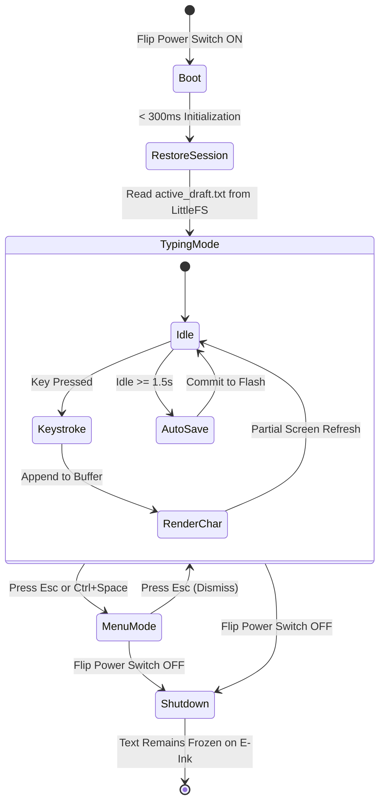

# ⌨️ E-Type Hardware: ESP32-S3 E-Ink Typewriter Architecture & Specification

A dedicated, distraction-free, instant-on hardware typewriter for first drafts, powered by an **ESP32-S3 N16R8** and **Waveshare E-Paper Display**.

---

## 1. Core Philosophy & Design Pillars

1. **Zero Boot Friction (< 300ms)**: Turn the switch on and write immediately. No Linux boot delays (15–30s), zero filesystem corruption risks on sudden power cut.
2. **Forward-Only by Default**: Preserves the core E-Type philosophy—no backspacing or editing during drafting unless explicitly switched to Edit Mode.
3. **Ghosting-Aware Typography**: High-contrast monospaced font with intelligent fast partial refreshes and periodic full waveform clears to wipe away ink residue.
4. **Offline & Distraction-Free**: WiFi radios are powered off during writing sessions to save battery and maintain focus; WiFi powers on strictly during on-demand sync.
5. **Fail-Safe Persistence**: Automatic silent saves to 16MB Flash every 1.5 seconds of idle time. You can cut power at any moment without losing work.

---

## 2. Hardware Bill of Materials (BOM) & Specifications

| Component | Specification / Model | Role |
| :--- | :--- | :--- |
| **Microcontroller** | **ESP32-S3 N16R8** (Dual-Core Xtensa LX7 @ 240MHz, 16MB Flash, 8MB Octal PSRAM) | System host, buffer management, USB host stack, LittleFS storage. |
| **Terminal Base** | ESP32-S3 Screw Terminal Breakout Board | Sturdy prototype wiring for screen, power, and sensors without loose jumper wires. |
| **Display (Phase 1)** | **Waveshare 4.2" Black & White E-Paper** (400×300 resolution, SPI) | Fast prototype screen (~300ms partial refresh, 15KB RAM buffer). |
| **Display (Phase 2 Upgrade)** | **6" E-Paper with IT8951 Controller** (1024×758 or 1448×1072, SPI/USB) | Production screen: A2 1-bit fast mode (~30–50ms / 15–20 FPS real-time typing). |
| **Keyboard** | USB-C Wired Keyboard (Standard USB 2.0 HID) | Native USB Host input via the S3's hardware D+/D- lines. |
| **Power Supply** | 5V DC via Terminal Base Screw Terminals (Spliced USB cable / 5V power bank / LiPo + Boost) | Powers ESP32, e-paper, and delivers 5V VBUS to the keyboard. |

---

## 3. Wiring & Pinout Diagram

> [!IMPORTANT]
> **Octal PSRAM / Flash Restriction**: On the **N16R8** module, **GPIO 33 through GPIO 37** are dedicated to internal high-speed memory and must **never** be connected to external peripherals.

### Screen to ESP32-S3 Wiring Table

| Waveshare 4.2" Pin | Wire Function | Recommended ESP32-S3 Pin | Notes |
| :--- | :--- | :--- | :--- |
| **VCC** | Power (3.3V) | **3.3V** | Never connect to 5V (damages driver chip) |
| **GND** | Ground | **GND** | Common ground |
| **DIN** | SPI MOSI | **GPIO 11** | High-speed SPI Data Out |
| **CLK** | SPI SCK | **GPIO 12** | SPI Clock |
| **CS** | Chip Select | **GPIO 10** | Active Low |
| **DC** | Data / Command | **GPIO 9** | Low = Command, High = Data |
| **RST** | Hardware Reset | **GPIO 8** | Active Low |
| **BUSY** | Busy Status | **GPIO 7** | High/Low depending on panel rev |

### Keyboard & Power Wiring
* **USB-C Keyboard**: Plugs directly into the ESP32-S3 USB-C port (connected internally to **GPIO 19 = USB D-** and **GPIO 20 = USB D+**).
* **Power**: 5V source connects to the terminal block **`5V` (or `VIN`)** and **`GND`**.

---

## 4. Power Lifecycle & State Machine



* **Boot**: Reads last draft file and cursor position; performs a fast partial refresh of the visible viewport.
* **Typing Loop**: Characters buffer instantly in PSRAM; partial updates push to the screen.
* **Auto-Save**: Background timer commits dirty text to Flash whenever typing pauses for 1.5 seconds.
* **Shutdown**: E-ink retains the last typed page indefinitely with zero power.

---

## 5. Mode Switching & Menu System

### Switching Mechanism
* **Default State**: Pure distraction-free writing canvas.
* **Open Menu**: Press **`Esc`** or **`Ctrl + Space`**.
* **Navigation**: **`↑` / `↓` Arrow keys** + **`Enter`** to select, or quick-select letters (`N`, `O`, `S`, etc.).
* **Exit**: Press **`Esc`** from anywhere in the menu to return immediately to writing.

### Menu Tree

```
┌────────────────────────────────────────────────────────┐
│  E - T Y P E   C O N T R O L   C E N T E R             │
├────────────────────────────────────────────────────────┤
│  [N] New Draft                                         │
│  [O] Open Draft...                                     │
│  [S] Save / Rename Draft                               │
│  [U] Upload & Sync (WiFi)...                           │
│  [M] Mode & Focus Settings...                          │
│  [D] Display & Typography...                           │
│  [X] System Info & Diagnostics                         │
│                                                        │
│  [Esc] Return to Drafting                              │
└────────────────────────────────────────────────────────┘
```

---

## 6. Detailed Feature Specifications

### 📂 [N] New Draft
* Prompts for title (or auto-generates sequential date name e.g., `2026-10-11-draft.md`).
* Automatically saves and closes current draft before creating the new file.
* Triggers a clean full-screen flash to reset the e-paper surface.

### 📜 [O] Open Draft
* Lists `.md` files stored in `/drafts/` partition:
  ```
  > chapter-01.md         (3,420 words • Oct 10)
    morning-thoughts.md   (  580 words • Oct 09)
    novel-outline.md      (1,120 words • Oct 07)
  ```
* Scrolling updates title, word count, and last modified timestamp.
* Selection loads document buffer and positions cursor at the very end.

### ☁️ [U] Upload & Sync (WiFi On-Demand)
> [!NOTE]
> WiFi is disabled during drafting to maximize battery life and prevent distraction. Choosing Upload spins up the WiFi module temporarily.

1. **Option A: Direct Google Drive Sync**:
   * ESP32 connects to local WiFi / phone hotspot.
   * Authenticates using saved OAuth refresh token and uploads/updates files in the designated Google Drive folder (`etype_drafts` or `flow_writings`).
2. **Option B: Local Web Server (`http://etype.local`)**:
   * The ESP32 hosts a lightweight web server on the local network.
   * Opening `http://etype.local` from a laptop, tablet, or phone displays a file manager where you can preview and download drafts with one click.
3. **Option C: USB Drive Mode (Mass Storage)**:
   * When connected directly to a computer via USB, the ESP32 can optionally present its `/drafts/` partition as a standard USB flash drive.

### ⚙️ [M] Writing Mode & Focus Settings

1. **Hemingway Mode (Default)**:
   * Forward-only drafting. `Backspace`, `Delete`, and arrow navigation are locked out.
2. **Flow Mode (Sprint Drafting with Stakes)**:
   * **Duration**: 1 to 10 minutes.
   * **Target Pace**: 10 to 80 WPM.
   * **Erase Speed**: Configurable levels:
     * *Level 1 (Slow)*: 1.0s / char (~1 char/sec)
     * *Level 2 (Relaxed)*: 0.5s / char (~2 chars/sec)
     * *Level 3 (Normal)*: 0.25s / char (~4 chars/sec)
     * *Level 4 (Fast)*: 0.166s / char (~6 chars/sec)
     * *Level 5 (Rapid)*: 0.125s / char (~8 chars/sec)
   * Pause past grace period triggers character evaporation.
3. **Full Edit Mode**:
   * Unlocks `Backspace`, `Delete`, arrow navigation, and line hopping for second-pass revisions.
4. **Session Word Count Goal**:
   * Sets target (e.g. 500 words). Status line shows subtle progress tracker.

### 🔤 [D] Display & Typography Settings
* **Refresh Cycle**: Automatic full-waveform flash interval to eliminate ghosting (`Every 100 words`, `Every page / 300 words`, or `Manual only`).
* **Font Size**: Small (14pt), Medium (18pt - Default), Large (22pt).
* **Status Bar Visibility**: `Always Visible`, `Hide During Active Typing (3s fade)`, or `Off`.

---

## 7. Quality-of-Life Hardware Additions ("What Else?")

1. **The Strikethrough Shortcut (`Ctrl + Backspace` or `Alt + X`)**:
   * Physical typewriter equivalent of crossing out a word (`XXXX`).
   * Wraps the preceding word in Markdown strikethrough (`the ~~wrnog~~ wrong word`), acknowledging the mistake while maintaining forward momentum.
2. **Manual Clean Screen Key (`F5`)**:
   * Forces an immediate 1-second full e-paper waveform refresh to wipe all ghosting on demand.
3. **Battery Monitor ADC**:
   * A 100kΩ / 100kΩ voltage divider reading LiPo battery voltage into an analog pin (**GPIO 4** or **GPIO 5**) displays an exact battery icon (`[||||] 84%`).
4. **Phone Hotspot Fallback**:
   * If home WiFi is out of range, the ESP32 automatically scans for your phone's personal hotspot to sync from anywhere.

---

## 8. Software Architecture & Library Stack

```
┌────────────────────────────────────────────────────────┐
│                   E-Type Application                   │
│   (Draft Manager, Forward Engine, Menu State Machine)  │
├─────────────────────────┬──────────────────────────────┤
│      UI & Graphics      │       Hardware & I/O         │
│  - GxEPD2 (E-Paper)     │  - EspUsbHost (USB Keyboard) │
│  - U8g2_for_AdafruitGFX │  - LittleFS (Flash Storage)  │
│    (Courier Type Fonts) │  - WiFi / HTTPS Client       │
├─────────────────────────┴──────────────────────────────┤
│               ESP32-S3 Arduino Core / ESP-IDF          │
└────────────────────────────────────────────────────────┘
```

* **Display**: `GxEPD2` (high-performance e-paper driver with partial refresh support).
* **Fonts**: `U8g2_for_Adafruit_GFX` (crisp monospaced typography with fast rendering).
* **Keyboard**: `EspUsbHost` (native USB Host HID keyboard driver).
* **Filesystem**: `LittleFS` partition (allocating ~8MB to 12MB of the 16MB Flash for local text storage).
