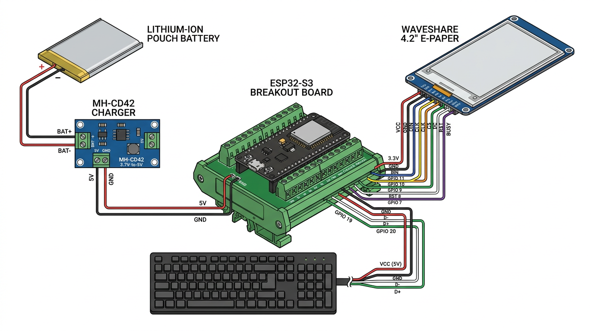
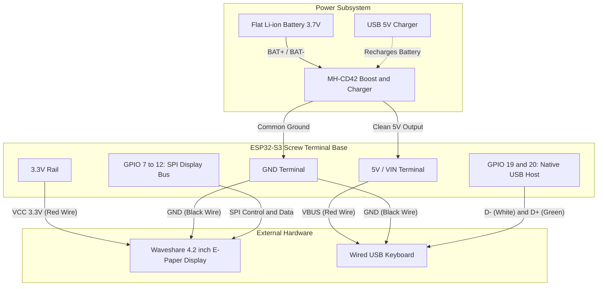

# ⌨️ E-Type Hardware: ESP32-S3 Firmware & Test Suite

This directory contains the firmware and hardware verification suite for the standalone **E-Type E-Ink Typewriter**, powered by an **ESP32-S3 N16R8** (16MB Flash, 8MB Octal PSRAM), a **Waveshare 4.2" E-Paper Display**, and portable battery power.

---

## 📁 Sketches in this Directory

| Sketch | Purpose | Status |
| :--- | :--- | :--- |
| [`01_system_check/`](./01_system_check/01_system_check.ino) | Verifies chip rev, dual 240MHz cores, 16MB Flash, 8MB Octal PSRAM, and LittleFS file persistence. | ✅ Tested & Verified |
| [`02_display_test/`](./02_display_test/02_display_test.ino) | Waveshare 4.2" SPI test: full screen clear, typewriter title card, and fast partial refresh line typing. | ⏳ Ready for cables |
| [`03_keyboard_test/`](./03_keyboard_test/03_keyboard_test.ino) | Native USB Host keyboard test: detects plug/unplug and echoes keystrokes live to Serial Monitor. | ⏳ Ready for keyboard |
| [`04_interactive_typewriter/`](./04_interactive_typewriter/04_interactive_typewriter.ino) | **Full Live Typing Prototype**: Real-time keystrokes render straight to the e-paper using fast partial updates, with thread-safe FreeRTOS queuing and F5 screen refresh. | 🚀 **Ready to Test** |

---

## 🔌 Complete Circuit Diagram (Screw Terminal Base + MH-CD42)

This setup uses your **Screw Terminal Breakout Board**, **MH-CD42 3.7V→5V Converter/Charger**, **Flat Li-ion Battery**, **Wired USB Keyboard**, and **Waveshare 4.2" E-Paper**.

### 🖼️ Visual Circuit Diagram


> 💡 *Vector version available: Open [`circuit_diagram.svg`](./circuit_diagram.svg) for an interactive, zoomable SVG schematic with exact pin labels.*

### Visual ASCII Schematic

```
                      +-----------------------------+
                      |   Flat Li-ion Pouch (3.7V)  |
                      |   (+) Red           (-) Blk |
                      +------+----------------+-----+
                             |                |
                             v                v
                      +-----------------------------+
   USB Charging In    |      MH-CD42 Module         |
   [Micro-USB/Type-C] | [BAT+]              [BAT-]  |
   ==================>|                             |
                      | [5V/VOUT]             [GND] |
                      +------+----------------+-----+
                             |                |
             +---------------+                +----------------+
             | (+5V Clean Rail)                                | (Common GND)
             |                                                 |
             v                                                 v
  ================================================================================
  ||                         ESP32-S3 SCREW TERMINAL BASE                       ||
  ================================================================================
  ||  [5V / VIN] <---+                         [GND] <---------+                ||
  ||                 |                                         |                ||
  ||  [3.3V] --------|--------+                [GND] <----+    |                ||
  ||                 |        |                           |    |                ||
  ||  [GPIO 11] -----|--------|------- DIN                |    |                ||
  ||  [GPIO 12] -----|--------|------- CLK    Waveshare   |    |                ||
  ||  [GPIO 10] -----|--------|------- CS     4.2"        |    |                ||
  ||  [GPIO  9] -----|--------|------- DC     E-Paper     |    |                ||
  ||  [GPIO  8] -----|--------|------- RST    Display     |    |                ||
  ||  [GPIO  7] -----|--------|------- BUSY               |    |                ||
  ||                 |        |                           |    |                ||
  ||  [GPIO 19] -----|--------|----------------------- D- |    |  USB Keyboard  ||
  ||  [GPIO 20] -----|--------|----------------------- D+ |    |  (Type-A)      ||
  ||                 +--------|----------------------- 5V |    |                ||
  ||                          |----------------------- GND-----+                ||
  ================================================================================
```

### Mermaid Architecture View



---

## 📌 Screw Terminal Pin-by-Pin Wiring Tables

### 1. Power Supply (MH-CD42 to Terminal Base)
The **MH-CD42** acts as both your 1S Li-ion charger and your 5V step-up boost converter.

| MH-CD42 Pin | Wire Destination | Role |
| :--- | :--- | :--- |
| **BAT +** | Battery Red Wire (+) | Raw 3.7V Li-ion positive |
| **BAT -** | Battery Black Wire (-) | Raw Li-ion ground |
| **5V / VOUT** | Screw Terminal **`5V` (or `VIN`)** | Regulated 5V rail for ESP32 and USB keyboard |
| **GND** | Screw Terminal **`GND`** | Common system ground |
| **KEY** *(Pad)* | Pushbutton to **`GND`** *(Optional)* | Wake/Power button if module enters low-load auto-sleep |

> [!TIP]
> **MH-CD42 Auto-Sleep Note**: If total current draw drops below ~45mA for 30s, the MH-CD42 may enter power-save mode. During typing, current draw (~60–90mA) keeps it active. If it powers off while idle, briefly grounding the **`KEY`** pad wakes it immediately.

---

### 2. Waveshare 4.2" E-Paper Display to Terminal Base

> [!CAUTION]
> **Voltage Warning**: The Waveshare E-Paper logic and power **must be 3.3V**. Connect its VCC pin strictly to the **`3.3V`** screw terminal, **never** to `5V`!

| Waveshare Pin | Wire Color (Stock) | Screw Terminal Pin | Role |
| :--- | :--- | :--- | :--- |
| **VCC** | Red | **`3.3V`** | 3.3V Logic & Power |
| **GND** | Black | **`GND`** | Ground |
| **DIN** | Blue | **`GPIO 11`** | SPI MOSI (Data to Display) |
| **CLK** | Yellow | **`GPIO 12`** | SPI SCK (SPI Clock) |
| **CS** | Orange | **`GPIO 10`** | Chip Select (Active Low) |
| **DC** | Green | **`GPIO 9`** | Data / Command Control |
| **RST** | White | **`GPIO 8`** | Hardware Reset |
| **BUSY** | Purple | **`GPIO 7`** | Busy Status Line |

---

### 3. Wired USB Keyboard to Terminal Base

You can connect your keyboard using a USB-A female breakout board, or by cutting open an old USB cable to expose its 4 colored wires:

| USB Wire | Standard Color | Screw Terminal Pin | Notes |
| :--- | :--- | :--- | :--- |
| **VBUS** | **Red** | **`5V` (or `VIN`)** | 5V power from the MH-CD42 rail |
| **D−** | **White** | **`GPIO 19`** | Native ESP32-S3 USB Host D− |
| **D+** | **Green** | **`GPIO 20`** | Native ESP32-S3 USB Host D+ |
| **GND** | **Black** | **`GND`** | Common ground |

> [!NOTE]
> If you prefer plugging a USB-C OTG dongle straight into the ESP32-S3's native USB port, verify that your DevKit board routes the 5V terminal pin to the USB port's VBUS line. If the keyboard LEDs do not light up, wire VBUS and GND to the screw terminals as shown above.

---

## ⚙️ Arduino IDE Configuration

### 1. Board Settings (`Tools` Menu)
* **Board**: `ESP32S3 Dev Module`
* **USB CDC On Boot**: **`Enabled`** *(Routes `Serial.print()` over the USB-C programming cable)*
* **Flash Size**: **`16MB (128Mb)`**
* **PSRAM**: **`OPI PSRAM`** *(Enables 8MB Octal PSRAM)*
* **Upload Mode**: `UART0 / Hardware CDC`
* **Erase All Flash Before Sketch Upload**: **`Disabled`**

### 2. Required Libraries
Install these via the Arduino Library Manager (**`Cmd/Ctrl + Shift + I`**):
1. **`GxEPD2`** by *Jean-Marc Zingg* (select **Install All** for Adafruit GFX dependencies).
2. **`EspUsbHost`** by *tanakamasayuki* (high-speed native USB Host keyboard driver).
3. **`Adafruit GFX Library`** by *Adafruit*.

---

## 🚀 Step-by-Step Test Sequence

1. **Step 1: Check Chip & Memory**:
   Upload [`01_system_check.ino`](./01_system_check/01_system_check.ino) to verify Flash, PSRAM, and LittleFS.
2. **Step 2: Verify E-Paper Display**:
   Screw in the Waveshare pins and upload [`02_display_test.ino`](./02_display_test/02_display_test.ino) to test full and partial refresh.
3. **Step 3: Verify USB Keyboard**:
   Connect keyboard D−/D+ to GPIO 19/20, upload [`03_keyboard_test.ino`](./03_keyboard_test/03_keyboard_test.ino), and check Serial Monitor keystrokes.
4. **Step 4: Live Typewriter Prototype**:
   Upload [`04_interactive_typewriter.ino`](./04_interactive_typewriter/04_interactive_typewriter.ino) and start typing! Press **`F5`** anytime to perform a clean full-screen refresh to clear ink ghosting.

---

## ⏳ E-Paper Refresh Mechanics & Ghosting Strategy

### Full Refresh vs. Partial Refresh Timing
| Refresh Mode | Duration on Waveshare 4.2" | What Happens Electrically | Visual Effect |
| :--- | :--- | :--- | :--- |
| **Partial Refresh** | **~300ms – 400ms** | Quick voltage kick to active pixels only. Leaves minor ionic charge residue. | Fast, instantaneous character display; faint ghosting accumulates after 30–50 updates. |
| **Full Screen Refresh** | **~2.0s – 3.0s** *(~1.5s on V2 panel)* | Runs full Look-Up Table (LUT) waveform sequence: alternates black/white flashes to reset microcapsule viscosity and balance charge. | 100% pure white background, zero ghosting, but flickers during the 2–3s cycle. |

### When to Trigger Intermittent Full Refreshes (Without Annoying the Writer)

1. **The "Thinking Pause" (Idle Detection)**:
   * Maintain a counter of partial refreshes or words typed since the last full clear.
   * If `ghostCount >= 40 words` **AND** user has paused typing for **> 4 to 5 seconds**, trigger a silent full clear. The screen refreshes while the writer is pausing to think, never interrupting active keystrokes.
2. **Paragraph Breaks (`Double Enter`)**:
   * Hitting Enter twice signifies the end of a thought/stanza. A brief 2s clean slate feels natural, akin to advancing a typewriter carriage.
3. **Screen / Page Full (Carriage Reset)**:
   * When cursor reaches the bottom line of the 4.2" display, clear and redraw cleanly at the top of the new page.
4. **On-Demand Manual Override (`F5` Key)**:
   * Always give the writer control: pressing **`F5`** (or `Ctrl + L`) triggers an immediate full refresh whenever they desire.

